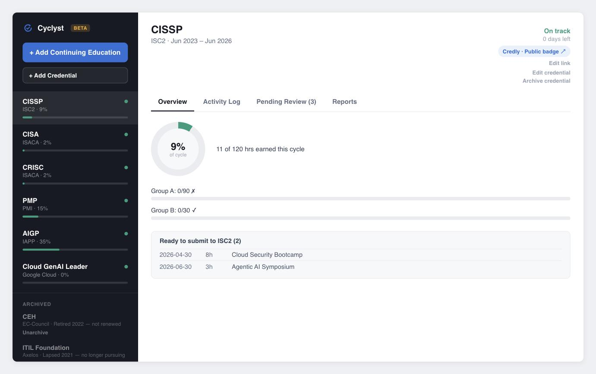
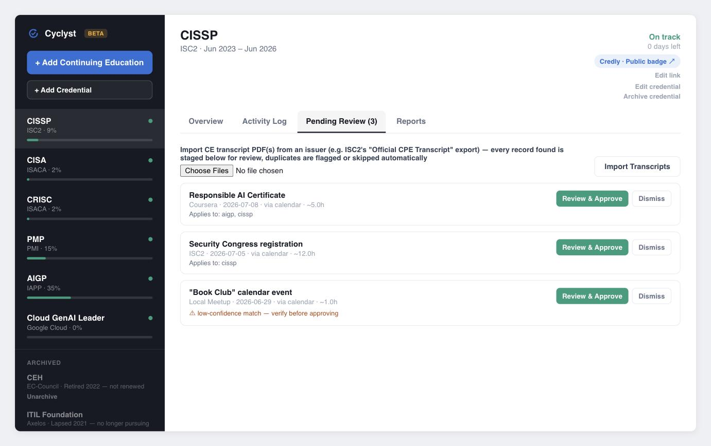

# Cyclyst

A self-hosted dashboard for tracking continuing-education (CE/CPE/PDU) requirements across
multiple professional certifications — local-first, private by default, and strictly
human-in-the-loop.

> "Life is like riding a bicycle. To keep your balance, you must keep moving" — Einstein,
> in a letter to his son Eduard, February 5, 1930. Renewal cycles work the same way: the
> credentials stay current as long as you keep moving through them. Cyclyst keeps you
> balanced across all of them at once.

> **Status:** BETA — working and in daily personal use, pre-1.0. Expect rough edges. Self-hosted
> only — there is no hosted version. The core tracker's data never leaves your machine, but
> two **optional** features do send data elsewhere: Calendar ingestion sends calendar data
> through Google's API to a connected AI-assistant session, and ISC2 portal submission
> automation runs through Claude for Chrome, which processes whatever's on the page during
> that session. Neither is on by default. See [Prerequisites](#prerequisites) below before
> using either.

> **Unofficial tool, use at your own risk.** Cyclyst is an independent project, not
> authorized, affiliated with, or endorsed by ISC2, ISACA, PMI, IAPP, or any other credential
> issuer or vendor named in this repo — and it is not endorsed or recommended by any employer
> or organization. It is intended for **one person tracking their own credentials**, not for
> tracking or submitting CE on someone else's behalf. It runs entirely on your own machine
> with your own accounts and logins — no hosted component, no telemetry, no data sent to the
> developer. It's built to accelerate CE tracking, not to remove you from the loop: nothing is
> saved to your record or submitted to an issuer's portal without your explicit review and
> go-ahead each time. Full text: [`DISCLAIMER.md`](DISCLAIMER.md).

## Screenshots

Both screenshots below are from `CE_TRACKER_DEMO=1` — fictional credentials and activities,
not real data.

**Per-credential progress**, computed live from cycle dates and logged hours:



**Pending Review queue**, staged from calendar ingestion and awaiting human approval:



## The problem

If you hold more than one professional certification, you already know the mess:

- **Every issuer runs a different clock.** ISACA (CISA, CRISC, CGEIT) reports on the
  *calendar year* with a hard January deadline; ISC2 (CISSP), PMI (PMP), and IAPP run
  three- or two-year cycles anchored to *your* certification anniversary. "Am I on pace?"
  means different math for each one, at the same time.
- **Every issuer counts differently.** Flat hour totals; category minimums (ISC2 Group A
  ≥ 90 of 120); category caps (PMI "Giving Back" ≤ 25 of 60); *nested* buckets (PMI's
  Talent Triangle legs living inside an "Education" floor); suggested vs. mandatory annual
  minimums; grace periods that exist for some issuers and not others.
- **One activity often counts several times.** A security-audit webinar can legitimately
  apply to CISA *and* CRISC *and* CISSP — but each portal wants its own entry.
- **Some credentials aren't hour-based at all** — they renew by re-exam on a fixed date, or
  they're valid only while another credential stays active.

The usual answer is a spreadsheet that can't answer the only question that matters — *"am I
going to make every deadline at my current pace?"* — plus an annual scramble to reconstruct
an itemized, evidence-backed record if an issuer audits you.

Cyclyst replaces that with one local dashboard: enter each credential's actual rules
once, log each activity once (tagged to every credential it applies to), and get computed
per-credential progress, pace status, and audit-ready reports.

## Design principles

1. **Local-first, private by default.** Your data is a single SQLite file in a gitignored
   `data/` directory. No accounts, no telemetry, no cloud services, nothing to sign up for.
2. **Human-in-the-loop, always.** Nothing writes to your CE record automatically. Suggested
   activities (e.g. from calendar ingestion, below) land in a *Pending Review* queue where
   you approve or dismiss each one. And nothing is ever submitted to an issuer's portal on
   your behalf.
3. **The issuer's portal stays the system of record.** This tracker is a private aggregator
   and early-warning system. "Manual adjustment hours" let you reconcile with totals the
   issuer's portal already confirms, without fabricating itemized entries.

## Features

- **Dashboard** with per-credential status (on track / at risk / in grace period /
  reminder-only), percent complete, and days remaining — all *computed on every page load*
  from your cycle dates and logged hours, never stored as stale numbers.
- **Real renewal semantics:** calendar-year vs. anniversary reporting windows, suggested vs.
  mandatory annual minimums, per-issuer grace periods, min/max category rules with
  arbitrary nesting, exam-only credentials (no CE, just an expiration to watch), and
  dependency cascades ("this credential lapses if that one does" — including *any-of*
  groups).
- **One activity, many credentials:** each logged activity applies to any set of
  hour-based credentials; category rollups update everywhere at once.
- **Certificate upload auto-fill:** attach a certificate of completion (PDF) on the Add
  Training form and it pre-fills date, hours, provider, and title where confidently found —
  local-only, no network call, no file ever saved to disk. You still review and save the
  form yourself.
- **Bulk transcript PDF import:** upload one or more issuer-exported transcript PDFs (e.g.
  ISC2's "Official CPE Transcript") from the Pending Review tab and every CE record found is
  staged for review at once — local-only, same as certificate upload. Only tested against
  ISC2's export so far; see [Transcript PDF import](#transcript-pdf-import-optional) below.
- **Agenda PDF import:** upload a multi-session-day conference or retreat agenda from the
  Pending Review tab and it stages one aggregate candidate — a suggested total hours plus an
  itemized session breakdown — for the whole event, rather than one row per session.
  Local-only, same posture as certificate and transcript upload. Supports two agenda layouts
  only; see [Agenda PDF import](#agenda-pdf-import-optional) below.
- **Pending-review queue** for ingested candidates, with duplicate detection against your
  existing log and sticky dismissals (a dismissed event never resurfaces). Calendar
  ingestion itself is optional and requires a separate MCP-connected AI-assistant session
  (this repo never talks to Google) — see [Calendar ingestion](#calendar-ingestion-optional-mcp-assisted)
  below.
- **Reports:** itemized CSV and audit-ready PDF exports scoped to a credential's current
  cycle window.
- **Activity Log retention (opt-in, never automatic):** archive activities older than a
  chosen number of years to declutter the Activity Log — a CSV backup is written first, and
  archiving never deletes anything or affects progress totals, reports, or duplicate
  detection. See [Activity Log retention](#activity-log-retention-optional) below.
- **Quality-of-life:** public badge links (Credly / Credential.net), archived credentials,
  in-app docs, in-place editing of everything — no hand-editing the database.
- **ISC2 portal submission automation (CISSP):** a submission-tracking ledger plus a
  human-supervised, one-record-at-a-time workflow for actually submitting approved activities
  to ISC2's live CPE portal — never autonomous, never batched, and requires a separate
  MCP-connected browser-automation session (this repo never drives a browser on its own). See
  [ISC2 portal submission automation](#isc2-portal-submission-automation-cissp-optional-mcp-assisted)
  below.

## Prerequisites

**To run the core tracker** (dashboard, manual credential/activity entry, certificate
upload, transcript import, reports): just Python 3.10+ — no accounts, no browser extensions,
no sign-ups. See [Quickstart](#quickstart) below.

**To use either optional MCP-assisted feature** — [Calendar
ingestion](#calendar-ingestion-optional-mcp-assisted) or [ISC2 portal submission
automation](#isc2-portal-submission-automation-cissp-optional-mcp-assisted) — you need more
than the tech stack, and the privacy posture changes for that session. Neither feature is
required for the core tracker to work, and neither is on unless you set it up and use it:

- **An account with the credential issuer, already logged in in your browser** (e.g. an ISC2
  account signed into `cpe.isc2.org` for portal submission). The automation drives your
  existing logged-in session — it never stores, enters, or has access to your issuer-portal
  password.
- **Claude for Chrome, installed and with site permissions granted** for the portal(s) you'll
  use it on (required for ISC2 portal submission automation; not needed for Calendar
  ingestion). This is Anthropic's browser extension: once enabled on a page, it can read that
  page's content and act on it (click, type, submit), and that content is processed by
  Claude to do so. Read Claude for Chrome's own terms of use and documentation, and
  understand what you're granting it access to, before enabling it on any page showing your
  CE data or an issuer-portal session.
- **An MCP-connected AI-assistant session** (Claude Code or claude.ai) with the connector the
  feature needs attached: the Google Calendar connector for calendar ingestion, or the
  Claude-in-Chrome browser-automation tool for portal submission. Attaching an MCP connector
  grants that session its full scope for as long as it's attached — e.g. the Calendar
  connector can read your whole calendar, not just events that look like CE, regardless of
  how narrowly this repo's own code queries it. Know what a connector can see and do before
  attaching it to a session that will touch your CE data.
- **Awareness that data leaves your machine for the duration of that session.** Calendar
  events pass through Google's API to the connected assistant session; whatever's on the
  portal page passes through Claude for Chrome to Anthropic while it's processing that page.
  This is a deliberate, opt-in trade for automation the core app doesn't need — see [Design
  principles](#design-principles) — but it means the "your data never leaves your machine"
  framing above only holds for the core tracker, not for these two optional features while
  they're in use.

## Quickstart

Requires Python 3.10+ (3.11+ recommended). No Node.js, no build step, no Docker required.

```bash
git clone https://github.com/mikhaelf/cyclyst.git
cd cyclyst
python3 -m venv .venv
source .venv/bin/activate
pip install -r requirements.txt
python run.py
```

> **Private repo:** if you clone over HTTPS, authenticate with `gh auth login` or a
> personal access token with `repo` scope. Collaborators must be added on GitHub before
> they can clone.

Open http://127.0.0.1:5000. A fresh install starts **empty** — click **+ Add Credential**
and enter your first credential's rules (cycle dates, renewal type, hour total, category
rules, grace period). Then log activities against it and the dashboard takes care of the
math.

> The page loads the small [HTMX](https://htmx.org) library from a CDN, so the browser
> needs internet access; your data still never leaves your machine.

### Try it with demo data

To explore the UI with a fictional sample portfolio (CISSP/CISA/CRISC/PMP-style credentials
with illustrative numbers) instead of starting empty:

```bash
CE_TRACKER_DEMO=1 CE_TRACKER_DB=/tmp/ce-demo.db python run.py
```

Demo seeding only ever touches an *empty* database, and pointing `CE_TRACKER_DB` at a
throwaway file keeps it out of your real data.

### Where your data lives

Everything is stored in `data/tracker.db` (SQLite), which is gitignored — it never enters
version control. Backups are just a copy of that one file.

> **Member ID field:** the optional Member ID on a credential stores a real issuer-account
> number (e.g. an ISC2 or ISACA member ID) in plaintext, same as the rest of the database.
> It appears on the dashboard (masked by default — click it to reveal) and, unmasked, in the
> title of exported PDF reports (it is not included in CSV exports). Review a PDF before
> sharing it, and avoid pasting real member IDs into seed data, screenshots, or bug reports —
> this project has previously had to scrub a leaked member ID from its own git history.

| Environment variable | Default | Purpose |
|---|---|---|
| `CE_TRACKER_DB` | `data/tracker.db` (under the repo root) | Path to the SQLite file. Use this to keep test and production data separate, or to store the DB outside the repo directory. |
| `CE_TRACKER_DEMO` | unset | Set to `1` to load fictional sample credentials on startup — **only if the database is empty**. |
| `CE_TRACKER_DEBUG` | unset | Set to `1` to enable Flask/Werkzeug debug mode (auto-reload plus an interactive in-browser debugger on unhandled exceptions). Local development only — never set this if the app might be reachable from anywhere but your own machine, since the debugger allows arbitrary code execution. |
| `CE_TRACKER_SECRET_KEY` | auto-generated | Flask's `SECRET_KEY`, used to sign CSRF tokens. Left unset, one is generated on first run and saved to `data/secret_key` (gitignored) so it survives restarts. Set this explicitly only if you need a specific key (e.g. sharing one across multiple processes). |

Example — isolated test database with demo data:

```bash
CE_TRACKER_DEMO=1 CE_TRACKER_DB="$HOME/ce-tracker-test/tracker.db" python run.py
```

### Uninstalling

The app, its Python dependencies (`.venv/`), and your data (`data/tracker.db`,
`data/secret_key`) all live inside the cloned repo directory by default — so deleting that
one directory removes all of it. Two things live outside it if you set them up:

- Any database you pointed `CE_TRACKER_DB` at outside the repo (e.g. per the "another macOS
  user account" setup above) — remove that path separately.
- Any shell aliases you added to `~/.zshrc` / `~/.bashrc` — remove those too, or they'll
  point at a deleted directory.

### What is in git vs. what you rebuild locally

| Piece | In git? | On a fresh machine / user account |
|---|---|---|
| Application code | Yes | `git clone` (then `git pull` for updates) |
| Python venv (`.venv/`) | No | Create with `python3 -m venv .venv` and `pip install -r requirements.txt` |
| Your tracker data (`data/tracker.db`) | No | Starts empty, or copy a `.db` file manually (see below) |
| `CLAUDE.local.md`, `.claude/` | No | Optional local notes / AI-tool config — copy only if you want them |
| Issuer handbook PDFs (`Credential Providers/`) | No | Local reference material only |

**Code sync:** push from one environment, `git pull` in another.

**Upgrading:** after `git pull`, the next `python run.py` applies any schema changes to
`data/tracker.db` automatically — no manual migration step needed. Back up `data/tracker.db`
first (a plain file copy) since this is beta software and schema changes aren't rolled back if
something goes wrong.

**Data sync:** never through git. Copy `tracker.db` explicitly, or use separate
`CE_TRACKER_DB` paths so environments do not accidentally share production data.

### Setup on another macOS user account (testing)

Each macOS user has their own home directory, so the usual pattern is: **same repo from
GitHub, separate database per account.** Do not copy `.venv/` across accounts — paths and
permissions differ; rebuild the venv instead.

#### Recommended: sandbox with demo data

Safest for UI or feature testing — no real cert numbers or activity history.

```bash
gh auth login   # or use HTTPS + a personal access token
git clone https://github.com/mikhaelf/cyclyst.git
cd cyclyst
python3 -m venv .venv
source .venv/bin/activate
pip install -r requirements.txt

CE_TRACKER_DEMO=1 CE_TRACKER_DB="$HOME/ce-tracker-test/tracker.db" python run.py
```

Open http://127.0.0.1:5000. Demo seeding runs only when the target database has no
credentials yet.

#### Optional: copy an existing database for realistic testing

Use this only when you intentionally want the same layout and records on the test account
(e.g. to reproduce a bug against real data). Stop the app on both accounts before copying.

On the **source** account:

```bash
cp /path/to/cyclyst/data/tracker.db /Users/Shared/ce-tracker-test.db
chmod 644 /Users/Shared/ce-tracker-test.db
```

On the **test** account:

```bash
git clone https://github.com/mikhaelf/cyclyst.git
cd cyclyst
python3 -m venv .venv && source .venv/bin/activate
pip install -r requirements.txt

mkdir -p data
cp /Users/Shared/ce-tracker-test.db data/tracker.db
python run.py
```

Remove the file from `/Users/Shared/` when finished if it contains sensitive cert data.

#### Optional shell aliases

Add to `~/.zshrc` or `~/.bashrc` on any account:

```bash
alias ce-tracker='cd ~/cyclyst && source .venv/bin/activate && python run.py'
alias ce-tracker-demo='cd ~/cyclyst && source .venv/bin/activate && CE_TRACKER_DEMO=1 CE_TRACKER_DB="$HOME/ce-tracker-test/tracker.db" python run.py'
```

Adjust the `cd` path if the repo lives somewhere other than `~/cyclyst`.

#### GitHub push note (email privacy)

If `git push` is rejected with an email-privacy error (GitHub error GH007), either allow
command-line pushes in [GitHub email settings](https://github.com/settings/emails) or set
your git author email to your GitHub noreply address:

```bash
git config --global user.email "YOUR_GITHUB_USERNAME@users.noreply.github.com"
```

New commits will use that address. Existing commits already in history keep their original
author email until you rewrite history (usually unnecessary once the first push succeeds).

## Using the tracker

1. **Add each credential** with its real rules. The form covers the whole schema: renewal
   type (`cpe_hours` / `exam` / `mandatory_module`), cycle start/end, reporting calendar
   (calendar-year or anniversary), hour total and unit, annual minimum (suggested or
   mandatory), grace period days, category min/max rules (nestable), dependencies, and
   "confirmed elsewhere" adjustment hours.
2. **Log activities** as you complete them — date, provider, title, hours, category, and
   *every* credential they apply to. Only hour-based (`cpe_hours`) credentials are offered
   as targets; exam-only credentials never accumulate hours. Optionally attach a certificate
   of completion (PDF) first and click **Extract Details** to pre-fill what it can find —
   review the fields before saving either way.
3. **Review pending items** (if you use ingestion): approve to commit an item to your log —
   you supply the category and applies-to yourself, the machine never guesses them — or
   dismiss it permanently.
4. **Export reports** from the Reports tab when renewing or when an issuer audits you:
   itemized CSV or PDF for the credential's current cycle.
5. **Archive** credentials you're letting lapse; they stay visible for reference but stop
   being tracked.

The in-app **Docs** page (📘 in the sidebar) covers the same ground from inside the tool.

## Calendar ingestion (optional, MCP-assisted)

The tracker can scan your Google Calendar for events that look like CE activities —
conferences, webinars, chapter meetings, trainings — and stage them for review. Its shape is
deliberately unusual, and requires a separate tool this repo does not provide:

- **The app itself never talks to Google.** There's no API client, no OAuth flow, no stored
  tokens, and nothing in this repo will fetch your calendar on its own. Instead, a live AI
  assistant session with calendar access — e.g. Claude Code or claude.ai with the Google
  Calendar MCP (Model Context Protocol) connector enabled — reads your calendar and exports
  events to a JSON file. You then hand that file to this repo's pure-Python CLI, which does
  all the scoring/staging locally with no further network calls:

  ```bash
  python -m ce_tracker.calendar_ingest --events-file events.json
  ```

  The file is a JSON array of standard Google Calendar API event resources. `--since` /
  `--until` override the scan window; by default each run resumes where the last one ended.

- **Scoring is tiered and conservative:** known CE providers (editable list at the top of
  `ce_tracker/calendar_ingest.py`) stage cleanly; generic CE keywords ("webinar",
  "symposium", "chapter meeting", …) stage *flagged* for closer review; an editable
  denylist ("1:1", "standup", "book club", …) never stages at all.
- **Everything lands in Pending Review.** The scorer never guesses which credential or
  category an event belongs to — you fill those in at approval. Duplicates of activities
  you already logged are detected and labeled with a confidence score.

Gmail ingestion (course-completion emails, registration receipts) is a planned follow-up
and intentionally not built yet.

## Transcript PDF import (optional)

The Pending Review tab also accepts one or more issuer-exported transcript PDFs at once —
ISC2's "Official CPE Transcript" export is the case this was built and tested against. Local
extraction only, same posture as certificate upload auto-fill: no network call, nothing saved
to disk beyond the parsed rows landing in Pending Review.

- **Handles multi-record transcripts, not just single certificates.** Every dated CE row in
  the file is extracted, including titles that wrap across multiple lines in the PDF.
- **Merges duplicate rows within one document.** Some issuers print the same activity under
  more than one heading in a single export — e.g. a concentration certification (ISSEP)
  sharing its base credential's (CISSP) CPE pool prints that pool's activities once per
  heading. These are recognized as the same activity, not staged twice.
  "Rollover" credit lines (a carried-over balance, not a real activity) are reported in a
  note instead of being staged as one.
- **Skips near-certain duplicates automatically.** A row that's essentially identical — same
  date, same title, same hours — to something already in your log or already awaiting review
  isn't staged a second time. Anything less certain still stages, flagged, for you to check.
- **⚠️ Not tested against every issuer.** This has only been validated against a real ISC2
  transcript export. Other issuers format their transcripts differently — layout, date
  format, how multi-credential sharing is represented, if at all — so a PDF from a different
  provider may extract incompletely, extract nothing useful, or need more correction at
  review than usual. Always check what actually got staged before approving it; nothing is
  ever added to your log without that review step regardless.

## Agenda PDF import (optional)

The Pending Review tab also accepts a multi-session-day conference or retreat agenda PDF —
distinct from a certificate or an issuer transcript. Local extraction only, same posture as
certificate and transcript upload: no network call, nothing saved to disk beyond the staged
candidate in Pending Review.

- **Stages one aggregate activity per agenda, not one row per session.** A conference is
  logged as a single activity — the itemized per-session breakdown is included for review,
  but there's no "merge several approved rows into one activity" step, so staging session-
  by-session isn't useful here.
- **Non-content sessions (meals, breaks, receptions, workout blocks, etc.) are excluded
  automatically** via an editable denylist (top of `ce_tracker/agenda_parse.py`) — everything
  else is treated as a candidate and included in the suggested total, so review the breakdown
  before approving.
- **Sessions with no resolvable end time are skipped from the total**, not guessed — noted in
  the breakdown as "duration unknown" rather than silently dropped.
- **Provider is left blank.** Unlike a certificate's issuer line, an agenda's host isn't
  reliably extractable across formats, so you fill it in at review, same as you already do
  for calendar-ingested candidates.
- **Only two agenda layouts are supported**, each validated against exactly one real sample:
  day headers with no year and explicit start–end time ranges ("Monday | June 22" /
  "8:40 AM - 9:30 AM Description"), or day headers with a year and single bulleted start
  times ("Thursday, June 4, 2026" / "9:00 a.m. - Description", duration inferred from the
  next session's start time). If the agenda's dates don't include a year, enter one in the
  optional **Year** field before importing. A third layout isn't guaranteed to parse — check
  what actually got staged before approving it.

## Activity Log retention (optional)

The Activity Log tab has an **Archive activities older than [N] years** control. It's a
deliberate, explicit action — nothing is ever archived automatically, and there is no
startup or scheduled purge.

- **Archives, never deletes.** Archiving only sets a flag that hides an activity from the
  default Activity Log view. The underlying row stays in `data/tracker.db`: progress
  totals, category rollups, CSV/PDF report exports, and duplicate detection on future
  imports all keep counting archived activities exactly like non-archived ones. Archiving
  is decluttering, not retention in the "delete old data" sense.
- **A CSV backup is always written first**, to `data/archives/activities-archived-<timestamp>.csv`
  (gitignored, alongside `data/tracker.db`) — a durable, human-readable copy of exactly what
  got archived, independent of the database itself.
- **Fully reversible.** Toggle **Show archived** on the Activity Log tab to see archived
  entries (dimmed, with an "Archived" badge) and unarchive any of them individually.
- **Applies to your whole log, not just the credential you have selected**, since one
  activity can apply to several credentials at once — the cutoff is a single date computed
  from "N years before today," applied across every credential's activities.
- There's deliberately no per-issuer-audit-window guidance baked in — issuers' own
  record-retention expectations vary and aren't tracked anywhere in this codebase, so picking
  a safe number of years is on you.

## ISC2 portal submission automation (CISSP, optional, MCP-assisted)

For ISC2 (CISSP), the tracker can go one step past tracking progress locally: it can help you
actually get approved activities onto ISC2's live CPE portal, with a human confirming every
single record before anything is submitted. Like calendar ingestion above, this repo doesn't
do the submitting itself — it requires a separate AI-assistant session with browser access.
Nothing here runs unattended:

- `ce_tracker/portal_submit.py` keeps a ledger (`activity_portal_submissions`) of which
  locally-logged activities have been submitted — or found already present — on ISC2's portal,
  per activity *and* per credential, since one multi-`applies` activity can be submitted to one
  issuer and not another.
- `list-ready` finds activities that apply to a credential and have no ledger entry yet, and
  prints a *suggested* ISC2 Category / CPE Type / Domain mapping based on keyword patterns —
  always a suggestion for human review on the live form, never auto-filled or assumed.
- Driving the actual browser is a live, human-supervised session using an MCP-connected
  browser-automation tool (e.g. Claude Code's Claude-in-Chrome extension): one record at a
  time, with an explicit go/no-go before each submission. This is the project's hard rule —
  no autonomous portal submission, ever, no batch auto-submit — made concrete.

The example below uses fictional providers/events to show the shape of a real run:

```
$ python -m ce_tracker.portal_submit list-ready --credential cissp
[41] 2025-01-14  2h    Northbridge Learning — "Threat Intel Roundup: Q1 Briefing"  (category: -)
      suggested ISC2 mapping (confirm before submitting): Education > Online webinars, podcasts and other online materials | domain: ?
[42] 2025-02-03  5h    Brightline Events — "Executive Risk & Governance Summit"  (category: -)
      suggested ISC2 mapping (confirm before submitting): Education > Industry Conference | domain: Security and Risk Management
[43] 2025-02-20  1.5h  Northbridge Learning — "Data Privacy: Recent Rulings"  (category: -)  [AUTO-REPORTING PROVIDER — check ISC2's live CPE List first; it may already be there under a different title/hours]
      suggested ISC2 mapping (confirm before submitting): Education > Online webinars, podcasts and other online materials | domain: ?
[44] 2025-03-11  4h    Fieldstone Ventures — "Fieldstone Con: Tech & Strategy"  (category: -)
      suggested ISC2 mapping (confirm before submitting): Education > Industry Conference | domain: Security Architecture and Engineering
```

A "[AUTO-REPORTING PROVIDER]" flag (an editable list at the top of `portal_submit.py`) marks
providers known to auto-report CPEs to ISC2 under their own partnership — not automatically a
duplicate, but a strong enough signal that the mandatory live re-check deserves extra scrutiny:
on the first real run, two activities from such a provider turned out to already be on ISC2's
list, once under a different title and once with a different hour count.

The Claude-in-Chrome session then re-checks ISC2's live "CPE List" for duplicates first, and
walks each clear activity through ISC2's "Add New CPE" form (Dates → Category & Detail → Domain
→ Review), pausing for an explicit go/no-go before the final, irreversible "Submit CPE" click.
After each approved submission:

```
$ python -m ce_tracker.portal_submit record-submission --activity-id 42 --credential cissp \
    --source automation --isc2-category Education --isc2-cpe-type "Industry Conference" \
    --isc2-domain "Security and Risk Management"
Recorded activity 42 as automation for cissp.
```

Once ISC2's own "record will update within the next 60 minutes" window has elapsed, a later
session reconciles the ledger against a fresh live check:

```
$ python -m ce_tracker.portal_submit list-pending-reconcile --credential cissp
[42] 2025-02-03  5h  Brightline Events — "Executive Risk & Governance Summit"  (submitted 2025-02-03, recorded 2025-02-03T14:02:11)

$ python -m ce_tracker.portal_submit confirm-submission --activity-id 42 --credential cissp
Confirmed activity 42 for cissp.
```

If ISC2's own record differs from what was logged locally — as happened for provider
auto-reported entries on the first real run — `--isc2-hours` / `--isc2-title` correct the local
activity to match: ISC2's accepted figure is the source of truth once something is actually live
there, not what was originally logged.

**Scope, honestly:** CISSP/ISC2 only for now (see `ce-cpe-tracker-design.md` §7a for the
duplicate-prevention design and confirmation semantics); category/domain suggestions are
heuristic and always reviewed by a human on the live form; and there is deliberately no way to
run this without a live, supervised browser session on the other end.

Every flag on every subcommand above has its own `--help` text (`python -m ce_tracker.portal_submit
<subcommand> --help`) — that's the full reference; the walkthrough above only covers the ones
you'll use most.

## Architecture

Single-language Python stack, chosen for hackability over ceremony:

| Layer | Choice |
|---|---|
| Web framework | Flask, server-rendered Jinja2 templates |
| Interactivity | HTMX + a little vanilla JS — no SPA, no Node toolchain |
| Storage | SQLite via the stdlib `sqlite3` module |
| PDF export | ReportLab |
| Certificate parsing | pypdf (local text extraction, no network) |

```
ce_tracker/
  db.py               schema, migrations, optional demo seed
  progress.py         all cycle/date/pace math (pure functions, no DB)
  views.py            row → template-context shaping
  routes.py           Flask routes (dashboard, CRUD, review, exports)
  reports.py          CSV/PDF generation
  calendar_ingest.py  event scoring + staging CLI (pure stdlib)
  certificate_parse.py  local PDF text extraction + field heuristics for upload auto-fill
  transcript_parse.py  bulk multi-record transcript PDF extraction + staging
  docs_content.py     in-app docs text
  templates/ static/  UI
run.py                dev entry point
tests/                unit tests (pure functions + in-memory SQLite)
```

Progress is **computed, not stored**: `progress.py` derives status, percent, pace, and
days-left from cycle dates and summed activity hours on every request, so the dashboard can
never drift out of sync with the log. The date math — leap-year anniversaries,
calendar-year vs. anniversary annual windows, grace periods, dependency cascades — is pure
functions over plain dicts, which is what makes it testable.

Design history lives in [`ce-cpe-tracker-design.md`](ce-cpe-tracker-design.md) (data model
and business rules) and [`design/ui-handoff/`](design/ui-handoff/) (the original UI
prototype).

## Testing

```bash
python -m unittest discover -s tests
```

The suite covers every `compute_progress()` branch (including leap-day and year-boundary
edges, nested category rollups, and the dependency cascade) and the calendar-event scorer —
all against plain dicts or in-memory SQLite. **No test reads or writes a real database
file.**

## Scope and honest limitations

- `cpe_hours` and `exam` renewal types are fully computed. `mandatory_module`
  (vendor-scheduled pass/fail refreshers) has schema columns reserved but no computation
  yet — it'll be added when a tracked credential actually needs it.
- Certificate upload auto-fill only reads text-layer PDFs — scanned/photographed
  certificates (image-only PDFs) aren't handled yet, and fields it isn't confident about are
  left blank rather than guessed. See `ce-cpe-tracker-design.md` §11 for the heuristic and a
  possible future LLM-based fallback (opt-in, not built).
- **Transcript PDF import is only tested against ISC2's export.** The row-extraction rules
  (table layout, date format, how a shared multi-credential pool is represented) were built
  and validated against one real issuer's transcript. Other issuers' exports aren't
  guaranteed to parse correctly, or at all — see `ce-cpe-tracker-design.md` §11a.
- Single-user by design. No auth, no multi-tenancy — run it on your own machine.
- The Flask dev server is fine for localhost use; put a real WSGI server (e.g. gunicorn)
  in front of it if you expose it beyond loopback. By default `run.py` binds to `127.0.0.1`
  only, so out of the box the app isn't reachable from another machine on your network at
  all — this only becomes a concern if you deliberately rebind it (e.g. to `0.0.0.0`) or run
  it somewhere (Docker, a VM, a cloud host) that maps its port out.

## Roadmap

- Dockerfile for easier self-hosting
- Route-level test coverage (business logic is covered; HTTP layer isn't yet)
- Gmail ingestion into the same pending-review queue (local-only, same
  explicit-signal-first philosophy)
- OCR fast-follow for scanned/image certificate uploads (`pytesseract`, adds a system
  dependency — deferred until local PDF-text parsing proves useful enough to justify it)
- Opt-in LLM-based fallback for certificate parsing when local heuristics miss — would be
  the project's first outbound network call, so off by default and disclosed clearly
- Extend portal submission automation past ISC2/CISSP to other issuers, once a second one's
  portal shape has been mapped

## Legal & disclaimers

Cyclyst is BETA software, provided as-is with no warranty. Full disclaimer text (personal-
use scope, no issuer affiliation/endorsement, privacy/security posture, and the human-in-the-
loop principle behind the design) lives in [`DISCLAIMER.md`](DISCLAIMER.md) — read it before
relying on this tool for a real renewal deadline. In short:

- **Personal use, one principal.** Built for one person tracking their own credentials on
  their own machine — not for tracking or submitting CE on someone else's behalf.
- **Unofficial and unaffiliated.** Not authorized, sponsored, or officially supported by
  ISC2, ISACA, PMI, IAPP, or any other issuer or vendor it references. Use at your own risk.
- **Not institutionally endorsed.** No employer or professional body vouches for it; it's a
  personal tool for staying ahead of your own deadlines.
- **Private by construction.** No hosted component, no telemetry, no data sent to the
  developer — everything runs on your machine against a local file.
- **Human-in-the-loop by design.** It accelerates tracking, it doesn't delegate
  accountability — every write to your record and every issuer-portal submission needs your
  explicit review and go-ahead. You're responsible for confirming what gets submitted is
  accurate.

## License

[MIT](LICENSE) — see the `LICENSE` file. Use it, fork it, run it commercially; no warranty.
